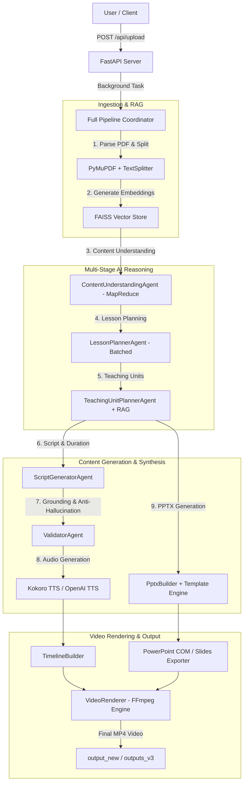

# 🎬 Olympiad AI Video Generator

An automated, end-to-end AI-powered pipeline that transforms educational textbooks and PDFs into narrated presentation videos with synchronized audio, slide decks, and subtitles.

---

## 📌 Architecture & System Overview



---

## 🚀 Key Features

1. **Intelligent PDF Ingestion & Semantic Chunking**:
   - Extracts formatted raw text from educational PDFs via PyMuPDF (`fitz`).
   - Recursively chunks text and builds a local **FAISS** vector store using semantic embedding models (`mxbai-embed-large` / `nomic-embed-text`).

2. **Map-Reduce Content Understanding**:
   - Breaks massive chapters into overlapping segments (6500 chars) to prevent LLM truncation and context overflow.
   - Extracts fine-grained syllabus subtopics, chapter titles, core definitions, and learning objectives.

3. **Batched Lesson & Slide Planning**:
   - Generates structured lesson sequences and teachable units in batches (5-15 units per batch) to avoid GPU VRAM thrashing.
   - Queries FAISS for dynamic, context-grounded retrieval (`top_k=8`) per slide.

4. **Script Generation & Semantic Grounding**:
   - Writes natural teacher-style narration scripts for every slide.
   - Includes a **ValidatorAgent** to detect hallucinations and ensure factual adherence to source material.

5. **Local Neural TTS (Text-to-Speech)**:
   - High-fidelity voice synthesis using **Kokoro v1.0 ONNX** (`af_heart` voice) running entirely locally, with OpenAI TTS as an optional fallback.

6. **Automated Slide Presentation Builder (`python-pptx`)**:
   - Dynamically binds generated titles and bullet points to custom branded PowerPoint templates (`template/template.pptx` or `Vydia_Template.pptx`).
   - Automatically injects intro and outro slides, speaker notes, and custom slide numbers.

7. **Multi-Threaded Video Rendering Engine**:
   - Exports presentation slides to high-resolution PNGs via PowerPoint COM automation.
   - Generates individual video segments for each slide and audio clip in parallel via **FFmpeg**, concatenating them into a seamless MP4.

---

## 📂 Project Structure

```
├── app/
│   ├── api/
│   │   └── routes/
│   │       ├── status.py             # Job status and progress tracking API
│   │       └── upload.py             # PDF upload and pipeline trigger API
│   ├── config/
│   │   ├── logging.py            # Loguru configuration
│   │   └── settings.py           # Pydantic BaseSettings & .env loader
│   ├── core/
│   │   ├── enums.py              # Status and type enums
│   │   └── exceptions.py         # Custom error hierarchy
│   ├── domain/
│   │   └── models/               # Domain Pydantic schemas (Slide, Audio, Job, etc.)
│   └── infrastructure/
│       ├── ai/
│       │   ├── agents/           # AI Agents (Understanding, Planner, Script, Validator)
│       │   ├── prompts/          # Prompt loading utilities
│       │   └── providers/        # LLM Providers (Ollama, Gemini, OpenAI, Router)
│       ├── audio/                # Kokoro & OpenAI TTS providers and AudioBuilder
│       ├── ingestion/            # PDF parsing via PyMuPDF
│       ├── presentation/         # PPTX builder, Slide builder, and templates
│       ├── queue/                # Pipeline orchestration tasks
│       ├── rag/                  # Text splitter and Local FAISS vector store
│       ├── state/                # Local job state persistence store
│       ├── synchronization/      # Timeline builder for audio/slide synchronization
│       └── video/                # FFmpeg video rendering engine
├── prompts/                      # Modular Markdown system prompts for LLMs
├── scripts/                      # Debugging, inspection, and standalone testing scripts
├── template/                     # PowerPoint presentation templates (.pptx)
├── main.py                       # FastAPI application entry point
├── pyproject.toml                # Project metadata and dependencies
└── .env.example                  # Environment configuration template
```

---

## 🛠️ Configuration & Setup

### 1. Environment Variables (`.env`)

Copy `.env.example` to `.env` and adjust the variables to your setup:

```env
# Application Settings
APP_NAME="Olympiad AI Video Generator"
PORT=8000

# LLM Provider (Local Ollama recommended)
DEFAULT_PROVIDER=ollama
DEFAULT_MODEL=qwen2.5:7b
OLLAMA_BASE_URL=http://127.0.0.1:11434
OLLAMA_EMBEDDING_MODEL=mxbai-embed-large:latest

# Cloud Keys (Optional)
GOOGLE_API_KEY=
OPENAI_API_KEY=

# Paths & Audio
FFMPEG_PATH=ffmpeg
TTS_MODEL=tts-1
TTS_VOICE=alloy
```

### 2. Local Ollama Setup

Ensure Ollama is running and has the required models:

```bash
ollama serve
ollama pull qwen2.5:7b
ollama pull mxbai-embed-large:latest
```

---

## 🖥️ Running the Application

### 1. Launch the Streamlit Web Studio (Recommended):
```bash
streamlit run app_ui.py
```
Open your browser at `http://localhost:8501` to use the interactive dashboard with drag-and-drop PDF upload, parameter sliders, live progress tracking, and embedded video player.

### 2. Start the FastAPI REST Server:
```bash
uvicorn main:app --host 0.0.0.0 --port 8000 --reload
```
Interactive API documentation will be available at `http://localhost:8000/docs`.

---

## 📡 API Endpoints

### 1. Upload Document & Start Pipeline
- **Method**: `POST`
- **Endpoint**: `/api/upload`
- **Body**: `multipart/form-data` (file: PDF)
- **Response**:
```json
{
  "job_id": "job_a1b2c3d4",
  "document_id": "chapter_1_f3e2"
}
```

### 2. Check Job Status & Progress
- **Method**: `GET`
- **Endpoint**: `/api/jobs/{job_id}/status`
- **Response**:
```json
{
  "job_id": "job_a1b2c3d4",
  "document_id": "chapter_1_f3e2",
  "status": "RUNNING",
  "stage": "audio_synthesis",
  "units_total": 24,
  "units_done": 12,
  "percent_complete": 50,
  "failure_reason": null
}
```

### 3. Health Check
- **Method**: `GET`
- **Endpoint**: `/health`
- **Response**:
```json
{
  "status": "healthy"
}
```

---

## 📊 Pipeline Stages (Step-by-Step)

1. **Stage 1 (Parsing & RAG Indexing)**:
   - PDF raw text extracted and indexed into a FAISS vector database.
2. **Stage 2 (Content Understanding)**:
   - Map-Reduce deep subtopic and concept extraction.
3. **Stage 3 (Lesson Planning)**:
   - Batched pedagogical curriculum sequencing.
4. **Stage 4 (Teaching Unit Generation)**:
   - Slide structure generation with dynamic RAG context retrieval.
5. **Stage 5 (Script Generation, Validation & Audio Synthesis)**:
   - Sequential LLM script producer + parallel Kokoro ONNX audio consumers.
6. **Stage 6 (Finalization & Video Rendering)**:
   - Assembles final PPTX, exports slide frames, and stitches video with FFmpeg.
